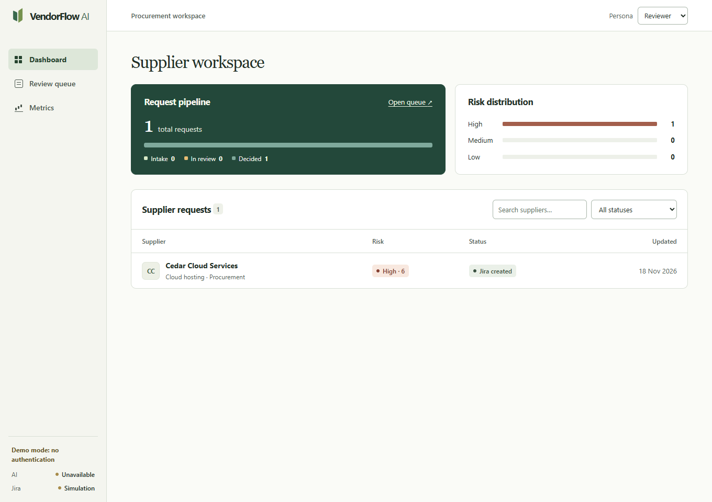

# VendorFlow AI

A local procurement review workspace built with Angular, FastAPI and LangGraph. A requester declares supplier evidence. Deterministic rules identify missing documents and calculate an illustrative risk score. Two bounded model stages draft a summary and recommendation with citations. A reviewer records the decision. Approval queues a Jira operation that the dispatcher can reconcile after a lost response.

[Watch the two-minute walkthrough (MP4)](docs/demo/vendorflow-demo.mp4) · [Fixed model vs. automatic routing](docs/routing-comparison.md) · [GitHub Actions](https://github.com/ahmedessammdev-hub/vendorflow-ai/actions/workflows/ci.yml)



## Run from a clean checkout on Windows

Use Python 3.12 managed by uv, Node 24.15+ within the 24.x series, npm and Microsoft Edge for the browser checks. Start in this repository root. For a fresh clone, copy the sample configuration once. Keep an existing local configuration when upgrading.

```powershell
Copy-Item .env.example .env
cd backend
uv sync --locked
cd ../frontend
npm ci
cd ..
uv run --project backend python scripts/seed_demo.py
```

In one terminal start the API from the repository root.

```powershell
cd backend
uv run uvicorn app.main:app --host 127.0.0.1 --port 8000
```

In a second terminal start the dashboard.

```powershell
cd frontend
npm start
```

Open [the dashboard](http://localhost:4200), [interactive API docs](http://127.0.0.1:8000/docs) or [health](http://127.0.0.1:8000/api/health). If the local ports are occupied, use `--port 8427` on uvicorn, then set `$env:VENDORFLOW_API_PORT = '8427'` before `npm start -- --port 4427`.

## Try the review

Choose **Requester**, open the seeded Cedar draft and submit it. Inspect the score, factors, declared evidence and AI status. Switch to **Reviewer**, open the review queue, enter a reason and decide. A successful simulated approval shows a plain-text SIM key. On Northstar, submit the incomplete draft, correct the missing evidence and resubmit. Open **Metrics** to see counts, token usage and model latency from the current workspace. [Demo script](docs/demo-script.md) · [Workflow and recovery](docs/workflows.md)

The seed is idempotent. The default setup works offline after dependency installation. A missing or unreachable provider shows AI Unavailable and the human can continue. To enable a compatible provider, put `LLM_BASE_URL` (including `/v1`), `LLM_API_KEY` and `LLM_MODEL` in the ignored root `.env`, then restart the API. A local FreeLLMAPI setup can use its dashboard's loopback port and model `auto`. Health reports the configured mode. A successful model call is verified separately. Optional timeout, token budget, reasoning effort and token prices are documented in [.env.example](.env.example).

Run a single worker. The API migrates its database at startup. Keep `vendorflow.sqlite` and `checkpoints.sqlite` together. Set `DATABASE_PATH` to an absolute path to isolate a workspace. The default Jira simulation uses the same outbox and delivery logic as live mode. The personas are for a local synthetic demo. [Limitations](docs/limitations.md)

## Verify and reproduce measurements

From the repository root, run these PowerShell commands in order. The collector runs lint, type checks, backend tests, frontend tests and build, browser journeys, accessibility scans, local HTTP smoke and the concurrency benchmark. The browser checks launch their own servers on ports 18742 and 14426. Smoke and benchmark databases are isolated. The collector reads the archived live evaluation and never initiates a paid run.

```powershell
uv run --project backend python scripts/verify_workflow.py
uv run --project backend python scripts/run_llm_eval.py
uv run --project backend python scripts/collect_metrics.py
```

For individual commands, see [AGENTS.md](AGENTS.md). To recapture screenshots in `docs/screenshots`, run `npx playwright test` from `frontend`. The collector saves its latest logs and browser captures under `.runtime/metrics/`. The separate live evaluation requires explicit authorization, a configured model, and `scripts/run_llm_eval.py --live`. By default the harness stops if neither stage of the first case returns a validated output. Use `--all-cases` for an authorized exhaustive run. A live Jira verification requires an existing request, its current version, the explicit reviewer decision and a test site. [Live verification procedure](docs/workflows.md)

## Measured results

The local verification report includes the original live evaluation as its baseline. The new paired run on the revised prompt is documented in the [routing comparison](docs/routing-comparison.md).

<!-- metrics:start -->

| Metric | Measured value | Target | Status |
|---|---|---|---|
| Backend tests | 177/177 | all pass | PASS |
| Pre-approval Jira creates | 0 | 0 | PASS |
| Coverage, overall | 94.7% | ≥85% | PASS |
| Browser journeys | 2/2 | 2/2 | PASS |
| 50 concurrent approvals | 1 accepted, 49 conflicts, 1 operation, 1 create, 1 issue | 1 operation and 1 create | PASS |
| Schema validity after repair | 12/20 (60.0%) | ≥95% | MISS |

<!-- metrics:end -->

[All measurements and commands](docs/metrics.md) · [VF acceptance evidence](docs/test-report.md) · [Architecture](docs/architecture.md) · [Implementation history](docs/implementation-log.md)
