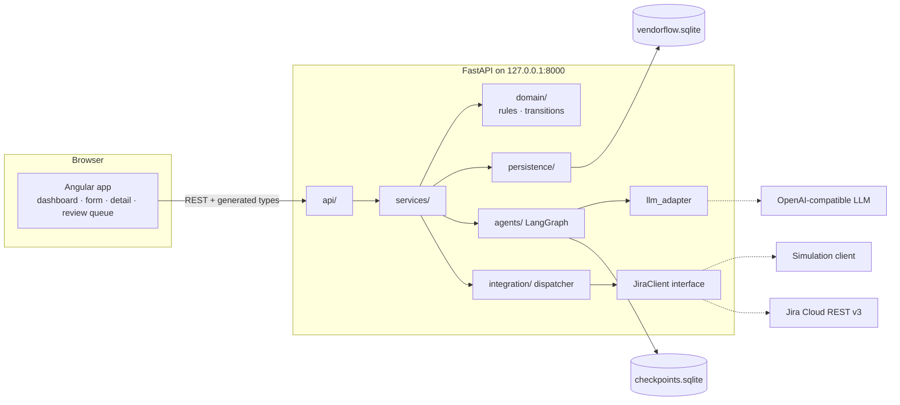
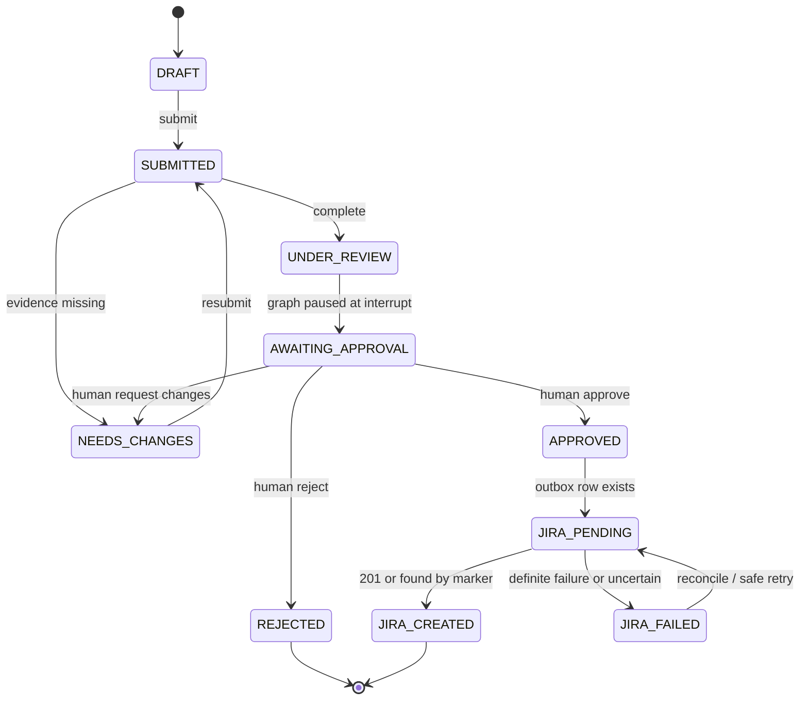
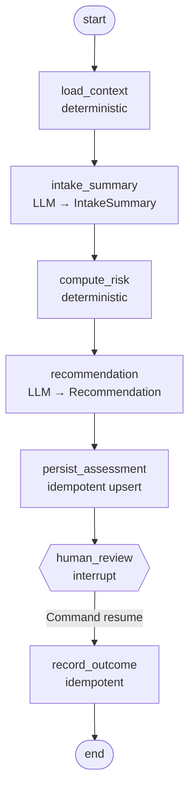
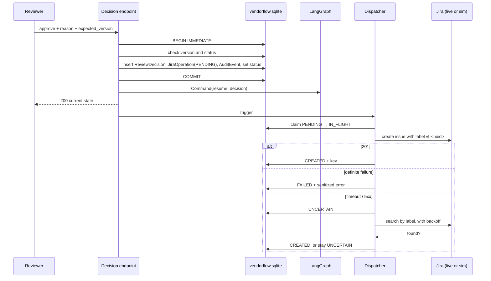

# Architecture

## One-sentence design

The LLM writes advice, a deterministic state machine and a human decide, and every external write goes through an outbox that can prove it ran at most once.

## Components

Dependencies point inward. `domain/` knows nothing about the web, the database, the LLM or Jira, so its rules can be tested as plain functions.

## Request state machine

Only `domain/transitions.py` holds this table. Every other layer asks it.

## Review graph

- `thread_id` is the request UUID.
- Nodes return partial state updates; LangGraph checkpoints after each node, so a restart continues from the last finished node and does not repeat a paid LLM call.
- `human_review` contains only the `interrupt()` call. A node restarts from its first line on resume, so nothing with side effects may sit before the interrupt.
- An LLM failure does not fail the graph. The node returns `ai_status` and the flow continues to the human.
- The graph has no Jira node.

## Decision and Jira outbox

Three independent guards stop a duplicate issue: the version check on the request, the UNIQUE constraint on `JiraOperation.request_id`, and the claim step in the dispatcher. Honest limit: Jira offers no idempotency key on create, and its search index is eventually consistent, so after an ambiguous failure the system cannot always know the truth by itself. In that case it stops and asks a human rather than guessing.

## Data model

| Table | Key columns | Constraints |
|---|---|---|
| `vendor_request` | id (UUID), vendor fields, status, version, timestamps | status CHECK; version increments on every write |
| `evidence` | request_id, kind, present, pointer | UNIQUE(request_id, kind); kind CHECK |
| `assessment` | request_id, score, band, factors, summary, recommendation, ai_status, model, prompt_version | UNIQUE(request_id, request_version) |
| `review_decision` | request_id, request_version, reviewer_label, action, reason | UNIQUE(request_id, request_version) |
| `jira_operation` | request_id, mode, status, issue_key, marker, attempts, last_error, last_checked_at | **UNIQUE(request_id)** |
| `audit_event` | request_id, actor_type, event_type, from_status, to_status, detail, created_at | insert-only in code |
| `llm_call` | request_id, node, model, prompt_version, latency_ms, tokens_in, tokens_out, outcome | — |

## Failure handling at a glance

| Failure | Behavior |
|---|---|
| LLM key missing or provider down | `ai_status = UNAVAILABLE`; request still reaches the human; UI says so |
| LLM returns bad JSON or fake field names | one repair try, then `INVALID_OUTPUT`; never auto-approves |
| Process dies during the graph | startup recovery re-invokes; checkpointer skips finished nodes |
| Process dies after decision commit, before resume | recovery resumes the thread from the stored decision |
| Process dies while calling Jira | operation becomes `UNCERTAIN`; reconcile by label |
| Double click or concurrent approve | one decision, one operation; others get the stored result or 409 |
| Stale browser tab | 409 with the current state; UI reloads |

## Architecture decision records

| ADR | Decision | Trade-off accepted |
|---|---|---|
| 001 | Human approval gates every external write | Slower than automation; that is the point |
| 002 | Jira via outbox + label reconciliation, outside the graph | More code than one API call; gives a defensible duplicate story |
| 003 | LLM as two schema-bound nodes, no tool calling | Less "agentic"; far more testable and cheaper |
| 004 | SQLite in WAL mode, two files | Single machine only; fine for a demo |

## Path to production (documented, not built)

Postgres with the LangGraph Postgres checkpointer; outbox drained by a queue worker; OIDC login with role-based access and reviewer ≠ requester enforcement; audit log in append-only storage; secrets in a vault; Jira through OAuth 2.0 (3LO) or a Forge app instead of a personal API token; OpenTelemetry traces; an evaluation set reviewed by procurement experts before any real use of the risk rubric.
